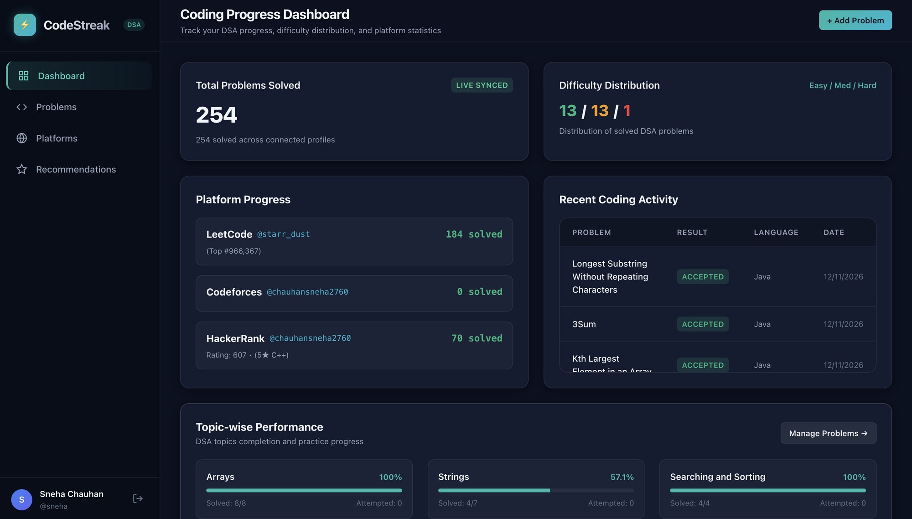
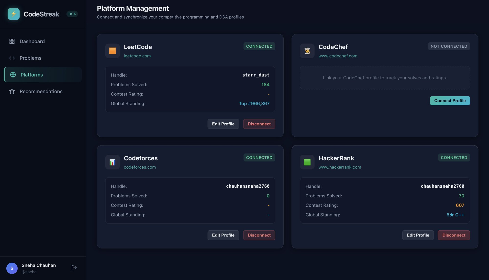
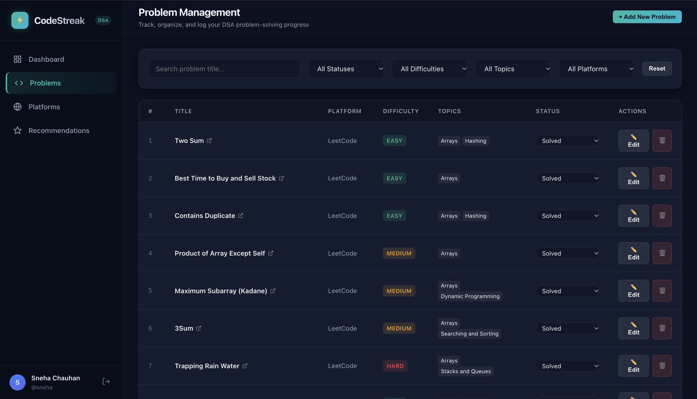
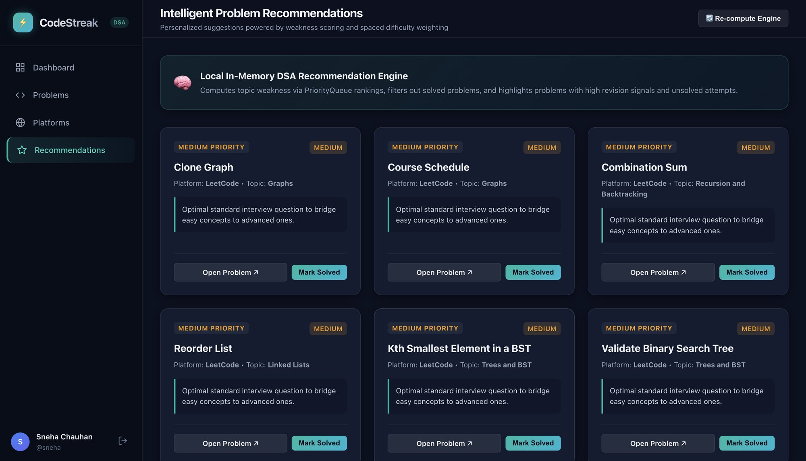

# CodeStreak ⚡

**CodeStreak** is a full-stack competitive programming and DSA progress tracking platform. It synchronizes external coding profiles (LeetCode, Codeforces, HackerRank), monitors topic mastery, logs problem-solving telemetry, and provides algorithmic recommendations tailored to user weaknesses.

Built using **Core Java (OOP), Jakarta Servlets, JDBC, PostgreSQL, HTML5, CSS3, and Vanilla JavaScript** without heavyweight frameworks.

---

## 📸 Screenshots & Application Preview

### 1. Coding Progress Dashboard
Live synchronization of connected platform profiles, difficulty distribution, recent activity log, and topic-wise performance metrics.


---

### 2. Platform Management & Live Auto-Fetching
Connect and automatically synchronize competitive programming profiles from LeetCode, Codeforces, and HackerRank via backend HTTP APIs.


---

### 3. Problem Management & Filtering
Comprehensive repository of DSA problems with multi-factor filters (Status, Difficulty, Topics, Platforms) and CRUD capabilities.


---

### 4. Intelligent Problem Recommendations
Weakness-prioritized recommendation engine powered by a Max-Heap `PriorityQueue` and topic attempt-to-solve ratio weighting.


---

## 🎯 Core Modules

1. **Dashboard** (`dashboard.html`): High-level overview of total problems solved across platforms, difficulty distribution (Easy / Medium / Hard), connected platform badges, recent coding activity, and topic mastery.
2. **Problems** (`problems.html`): Search and filter by difficulty, topic, and platform. Add, edit, or delete custom problems; track status (`Not Started`, `Attempted`, `Solved`, `Revision Needed`); and store personal notes.
3. **Platforms** (`platforms.html`): Live profile integration with automated data fetching for **LeetCode** (GraphQL API), **Codeforces** (REST API), and **HackerRank** (REST API).
4. **Recommendations** (`recommendations.html`): In-memory DSA recommendation algorithm ranking candidate problems based on topic weakness index, difficulty weight, and revision urgency using Java Data Structures (`PriorityQueue`, `HashMap`, `HashSet`).

---

## 💻 Tech Stack & Architecture

- **Backend**: Java 17, Jakarta Servlets 6.0, JDBC (PostgreSQL Driver)
- **Database**: PostgreSQL 16/18 with HikariCP connection pooling
- **Application Server**: Apache Tomcat 10.1
- **Frontend**: Responsive HTML5, Vanilla JavaScript (Async Fetch API), CSS3 Custom Variables (Dark Cyberpunk / Glassmorphism Theme)
- **External APIs**: LeetCode GraphQL, Codeforces REST API, HackerRank REST API

---

## 🚀 Running the Application Locally

### 1. Database Setup
Create database `codestreak` in PostgreSQL and run schema migration:
```bash
psql -U postgres -d codestreak -f src/main/resources/schema.sql
```

### 2. Build with Maven
```bash
export JAVA_HOME="/opt/homebrew/opt/openjdk@17"
export PATH="/opt/homebrew/opt/openjdk@17/bin:$PATH"

mvn clean package -DskipTests
```

### 3. Deploy to Tomcat 10.1
```bash
cp target/codestreak.war /opt/homebrew/Cellar/tomcat@10/10.1.61/libexec/webapps/
/opt/homebrew/opt/tomcat@10/bin/catalina start
```

### 4. Access the Platform
- **Local URL**: [http://localhost:8080/codestreak/](http://localhost:8080/codestreak/)
- **Demo Account**: `demouser` / `password123`
